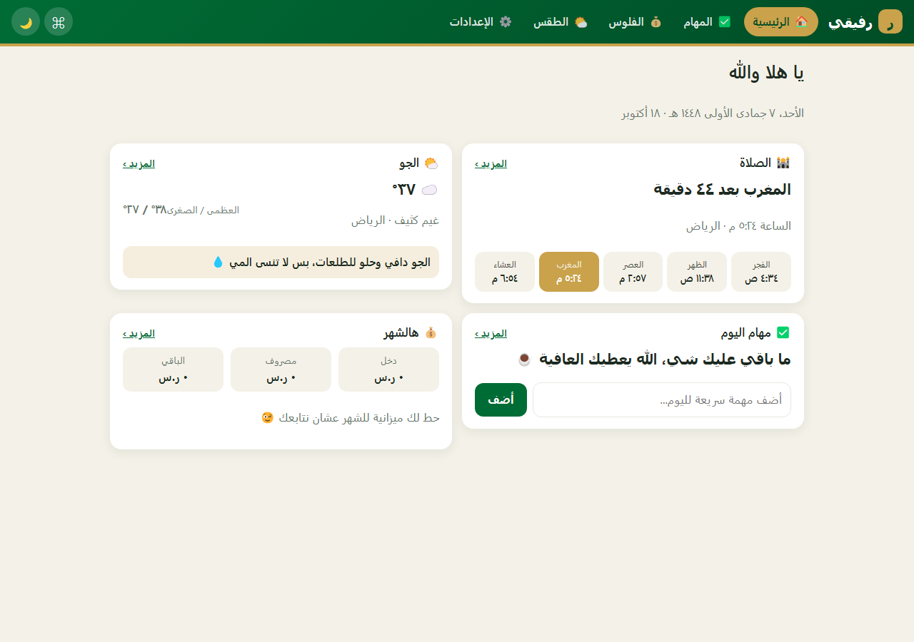
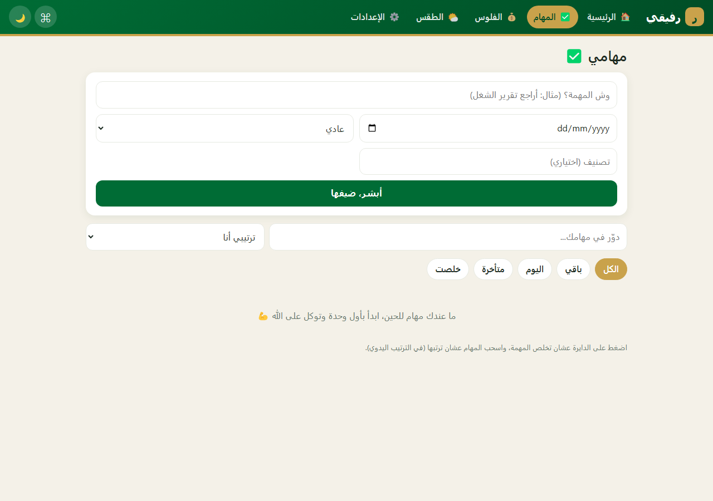
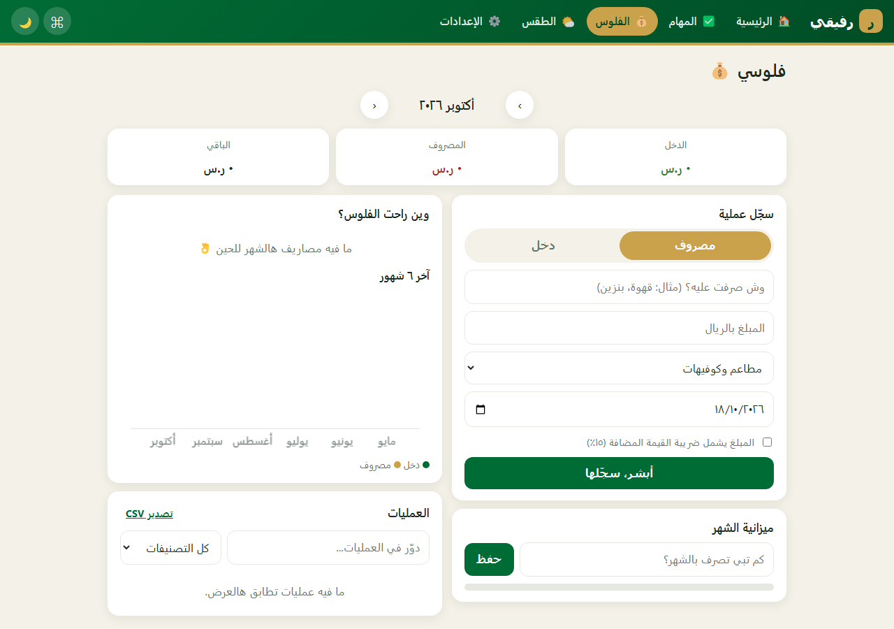
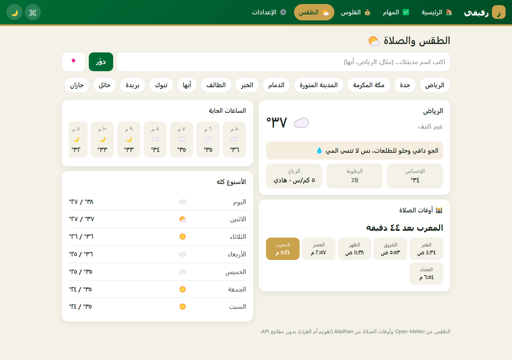
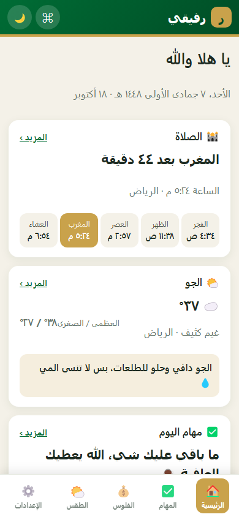

# رفيقي 🇸🇦

تطبيق ويب متكامل (PWA) يجمع **مهامك وفلوسك والطقس وأوقات الصلاة** في مكان واحد، بواجهة عربية RTL ولهجة سعودية.
مكتوب بالكامل بـ HTML + CSS + JavaScript خالص، بدون أي مكتبة أو أداة بناء.



<table>
<tr>
<td></td>
<td></td>
</tr>
<tr>
<td></td>
<td></td>
</tr>
</table>

## التشغيل

- **الأسرع:** افتح `index.html` في المتصفح مباشرة.
- **كتطبيق قابل للتثبيت (PWA، يشتغل بدون نت):** شغّل سيرفر محلي من داخل المجلد ثم افتح العنوان:
  ```bash
  python3 -m http.server 8000
  # افتح http://localhost:8000
  ```
- **الاختبارات:** افتح `tests.html` (١٩ اختبار وحدات تشتغل في المتصفح).

## الصفحات

| الصفحة | وش فيها |
|---|---|
| الرئيسية | تحية حسب الوقت، التاريخ الهجري، الصلاة الجاية مع عدّاد تنازلي، الطقس، مهام اليوم، ملخص الشهر، إضافة مهمة سريعة |
| المهام | أولوية، موعد ("اليوم، بكرة، متأخرة يومين")، تصنيفات، بحث، فلاتر، ٤ طرق ترتيب، سحب وإفلات + أزرار ↑↓، تعديل، حذف مع **تراجع** |
| الفلوس | ريال سعودي، ضريبة ١٥٪، ميزانية شهرية وتنبيهات، رسم دائري وأعمدة (آخر ٦ شهور) بـ Canvas، بحث وفلتر، تعديل، تراجع، تصدير CSV |
| الطقس والصلاة | ١٤ مدينة سعودية، بحث عن أي مدينة، تحديد الموقع، الساعات الجاية وتوقعات الأسبوع، أوقات الصلاة (تقويم أم القرى) |
| الإعدادات | الاسم، الثيم (تلقائي/نهاري/ليلي)، المدينة، نسخة احتياطية واستعادة JSON، اختصارات، تصفير |

**اختصارات:** `Ctrl+K` أو `/` لوحة الأوامر، `N` مهمة جديدة.

## المفاهيم البرمجية

- **معمارية:** ملفات منفصلة بدون Modules (تشتغل من `file://`): نواة (`core.js`) ← بيانات (`store.js`) ← خدمات (`weather.js`) ← واجهات (`views/*`) ← راوتر (`app.js`).
- **Router** بالـ URL hash، و**mount/unmount لكل واجهة** (تنظيف المؤقتات والمستمعين لمنع تسرب الذاكرة).
- **ناقل أحداث (Pub/Sub)** يربط البيانات بالواجهات، مع دالة إلغاء الاشتراك.
- **دالة `h()`** (hyperscript) لبناء DOM بدون `innerHTML` ← حماية من XSS (مغطاة باختبار).
- **طبقة بيانات** مع تنظيف وتحقق لكل مدخل (sanitize)، **ترقية نسخة البيانات** (schema v2)، واستيراد آمن للنسخ الاحتياطية الملوثة.
- **Undo** لكل عمليات الحذف، **تفويض أحداث** (Event Delegation)، **Drag & Drop** وHTML5 `<dialog>`.
- **async/await + `Promise.allSettled` + `AbortController`** (مهلة ١٠ ثواني)، **كاش مع رجوع للنسخة القديمة عند انقطاع النت**، وتجاهل الردود القديمة (race conditions).
- **PWA:** `manifest` + Service Worker (network-first مع احتياط الكاش).
- **إمكانية الوصول:** `aria-*`، تركيز واضح، تنقل بالكيبورد، `prefers-reduced-motion`، ثيم يتبع إعدادات الجهاز.
- **تصميم متجاوب:** شريط تنقل سفلي على الجوال، شبكة تتكيف على الشاشات الكبيرة.

## الخدمات الخارجية (بدون مفاتيح)

- الطقس والبحث عن المدن: [Open-Meteo](https://open-meteo.com/)
- أوقات الصلاة: [Aladhan API](https://aladhan.com/prayer-times-api) (method=4، أم القرى)

## المصادر والأفكار

الأفكار العامة (قايمة مهام، متتبع مصاريف، تطبيق طقس) مستوحاة من مشاريع مفتوحة المصدر برخصة MIT على GitHub. الكود هنا مكتوب من جديد.

## بيانات المستخدم

كل شي يتخزن في متصفحك (localStorage) ولا يُرسل لأي سيرفر. نزّل نسخة احتياطية من الإعدادات بين فترة وفترة.
